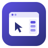
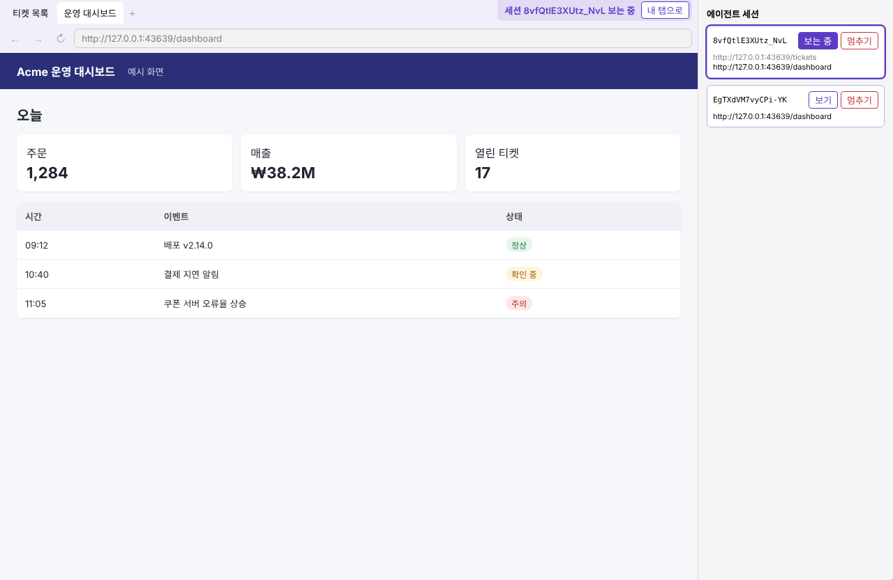
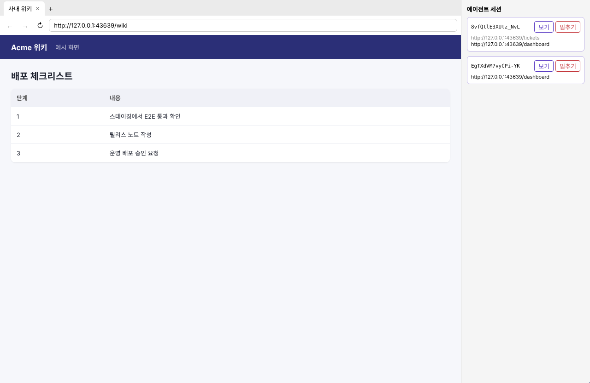
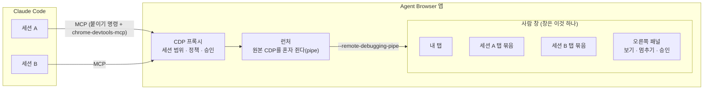

<p align="center">
  
</p>

<h1 align="center">Agent Browser</h1>

<p align="center">
  <b>Claude Code 세션 여러 개가 내 브라우저 하나를, 내 로그인 그대로 나눠 쓴다.</b><br>
  창은 하나, 세션은 여럿. 에이전트는 자기 탭만 보고, 위험한 동작은 사람이 허락한다.
</p>

<p align="center">
  <a href="#빠른-시작">빠른 시작</a> ·
  <a href="#쓰는-법">쓰는 법</a> ·
  <a href="#동작-방식">동작 방식</a> ·
  <a href="#안전-장치">안전 장치</a> ·
  <a href="#문서">문서</a> ·
  <a href="#개발">개발</a>
</p>

<p align="center">
  
  
  
  
  <a href="https://github.com/luminFrost/agent-browser/releases/latest"></a>
  
</p>

<p align="center">
  
  <br><sub>오른쪽 패널에서 세션을 고르면 그 세션의 탭이 왼쪽에 읽기 전용으로 보인다. 화면 속 페이지는 예시다.</sub>
</p>

---

## 왜 Agent Browser인가

- **로그인 그대로.** 에이전트 탭은 사람 탭과 쿠키를 함께 쓴다. 회사 계정에 한 번 로그인하면 Claude도 그 화면에서 일한다.
- **창 하나.** 세션마다 창이 새로 뜨지 않는다. 모든 세션은 사람 창 안에 탭 묶음으로 있고, 오른쪽 패널이 목록이다.
- **세션끼리 격리.** 에이전트는 자기 세션의 탭만 보고 다룬다. 사람의 탭이나 다른 세션의 탭은 보이지도 않는다.
- **사람이 최종 승인.** 에이전트 탭의 폼 제출(POST)과 다운로드는 사람이 허용해야 진행된다.
- **지켜보기와 멈추기.** "따라 보기"를 켜 두면 에이전트가 움직이는 화면이 자동으로 뜬다. "보기"로 골라 보고, "멈추기"로 그 세션을 바로 끊는다.
- **붙이기는 한 줄.** `claude mcp add`로 한 번 등록하면 모든 프로젝트의 Claude Code가 쓴다. 앱이 꺼져 있으면 알아서 켠다.

## 빠른 시작

소스는 필요 없다. 앱을 설치하고 Claude Code에 한 줄로 연결한다. Apple Silicon Mac과 Claude Code만 있으면 된다.

**1. 내려받기:** [최신 Release](https://github.com/luminFrost/agent-browser/releases/latest)에서 `Agent-Browser-<버전>-arm64.dmg`를 받는다.

**2. 설치:** dmg를 열어 **Agent Browser**를 **응용 프로그램(Applications)** 폴더로 끌어 놓는다.

**3. 처음 열기:** 서명하지 않은 앱이라 처음 한 번은 막힌다. Finder에서 **우클릭 → 열기**를 누르거나, 시스템 설정 → 개인정보 보호 및 보안 → **그래도 열기**를 누른다. 회사 정책이 서명 없는 앱을 막으면 IT 담당과 상의한다.

**4. Claude Code에 연결(한 번만):** 터미널에서 실행한다. 사용자 범위라 모든 프로젝트의 Claude Code가 쓴다.

```sh
claude mcp add --scope user agent-browser -- "/Applications/Agent Browser.app/Contents/Resources/agent-browser-mcp"
```

**5. 로그인:** 사람 창에서 회사 계정에 로그인해 둔다. 에이전트 탭도 이 로그인을 함께 쓴다.

> Claude Code에게 통째로 맡겨도 된다. 아무 폴더에서 Claude Code를 열고 이렇게 말한다.
> `https://github.com/luminFrost/agent-browser/blob/main/docs/setup.md 대로 agent-browser 설치해 줘`

### 업데이트

**새 버전이 있는지 확인**

```sh
defaults read "/Applications/Agent Browser.app/Contents/Info" CFBundleShortVersionString   # 설치된 버전
```

이 숫자를 [최신 Release](https://github.com/luminFrost/agent-browser/releases/latest)의 버전(맨 위 배지에도 보인다)과 비교한다. 더 높으면 새 버전이다. Release 노트에 무엇이 바뀌었는지(합친 PR 목록)가 나온다. 새 버전이 나올 때 알림을 받으려면 GitHub 저장소에서 **Watch → Custom → Releases**를 켠다.

**업데이트하기**

1. 앱을 끈다.
2. 새 Release의 dmg로 2번을 다시 한다(덮어쓰기). 로그인 정보는 그대로 남는다.
3. MCP는 다시 등록하지 않아도 된다(경로가 같다). Claude Code에서 `/mcp`로 다시 연결한다.

> 업데이트한 뒤 Mac에서만 볼 수 있는 동작(최소화·Cmd+H, 다른 앱 포커스, 승인 알림)은 [`docs/verify/20261123-company-pc-check.md`](docs/verify/20261123-company-pc-check.md) 확인표로 확인한다.

> Claude Code에게 "agent-browser 업데이트 확인해 줘"라고 해도 된다. [`docs/setup.md`](docs/setup.md)의 "업데이트" 절차대로 버전을 비교하고, 새 버전이면 설치까지 한다.

<details>
<summary>소스로 빌드해서 설치하기 (개발자용)</summary>

Node 22 이상이 있는 Mac에서:

```sh
git clone https://github.com/luminFrost/agent-browser.git && cd agent-browser
scripts/install-mac.sh          # npm ci → npm run dist → 앱 복사 → claude mcp add
```

지우는 방법은 [`docs/setup.md`](docs/setup.md)의 "지우기"에 있다.

</details>

## 쓰는 법

Claude Code에 이렇게 시키면 된다.

> agent-browser로 사내 지원센터의 열린 티켓 목록을 열고 긴급한 것만 정리해 줘

| 내 탭으로 일하는 중 | 세션을 골라 지켜보는 중 |
|---|---|
|  |  |
| 에이전트 세션은 패널에 보이고, 내 화면은 그대로다 | "세션 ○○ 보는 중" 표시와 함께 주소창·이동 버튼이 잠긴다 |

- Claude Code 세션이 시작되면(MCP 서버가 뜰 때) 오른쪽 패널에 그 세션이 생긴다. 새 창은 뜨지 않는다. 탭은 사람 창 안에 있다.
- **세션 이름:** 패널에는 세션마다 이름이 보인다. 기본은 Claude Code를 연 프로젝트 폴더 이름이고(같은 이름이면 ` 2`, ` 3`), 이름 옆 **✎**로 바꿀 수 있다(Enter 저장, Esc 취소). 처음부터 정하려면 MCP를 등록할 때 환경 값을 준다(`--env`는 서버 이름 바로 앞에 두지 않는다):

  ```sh
  claude mcp add --env AGENT_BROWSER_LABEL=<이름> --scope user agent-browser -- "/Applications/Agent Browser.app/Contents/Resources/agent-browser-mcp"
  ```
- **따라 보기**(패널 위 스위치, 처음엔 켜져 있다): 에이전트가 새 세션을 열거나 페이지를 옮기면 그 세션 화면이 자동으로 왼쪽에 뜬다. 내 일을 할 때는 끄거나 **내 탭으로**를 누른다(누르면 따라 보기가 꺼진다). 값은 앱을 다시 켜도 남는다. 승인을 기다리는 세션을 보는 동안은 다른 세션이 움직이거나 새 승인을 요청해도 화면을 옮기지 않는다(새 요청은 승인 줄·알림으로 알린다).
- **모양**(패널 아래 선택, 메뉴 **보기 > 모양**): Chrome처럼 **기기**(macOS 설정을 따름, 처음 값) · **밝게** · **어둡게**. 어둡게면 사람 창이 Chrome 어두운 색이 되고, 어두운 모드를 지원하는 웹 페이지도 어둡게 보인다. 값은 앱을 다시 켜도 남는다.
- 패널에서 **보기**를 누르면 왼쪽에 그 세션의 탭이 보인다. 보는 동안 주소창·이동 버튼은 잠기고 페이지를 누르거나 쳐도 에이전트 페이지에 닿지 않는다(휠 스크롤은 된다). **내 탭으로**를 누르면 돌아온다. 에이전트가 다른 탭으로 옮겨 가면(`select_page`) 보는 화면도 그 탭으로 바뀐다.
- **멈추기**를 누르면 그 세션이 바로 끝난다.
- Claude는 붙을 때 MCP 안내로 쓸 때 알아야 할 것(자기 세션의 탭만 보임, 사람 승인, 막힌 도구)을 받는다.
- 앱이 꺼져 있으면 붙이기 명령이 앱을 켠다. 15초 안에 못 켜면 Claude Code에 MCP 연결 실패로 보인다.
- Claude Code 세션이 끝나면 그 세션은 5초 안에 패널에서 사라진다. 강제 종료돼도 같다. 그 세션을 보던 중이면 내 탭으로 돌아온다.
- 사람이 패널에서 그 세션의 **멈추기**를 누르면 그 세션은 더 이상 브라우저를 쓰지 못한다. 다시 쓰려면 Claude Code에서 `/mcp`로 다시 연결한다.

## 동작 방식



- **런처만 원본 CDP를 쥔다.** 브라우저는 `--remote-debugging-pipe`로만 열리고 브라우저 자체의 TCP 디버그 포트는 없다([ADR-0002](docs/adr/0002-launcher-pipe.md)). 세션마다 받는 `browserUrl`은 그 세션 범위로 걸러진 프록시이고, 추측할 수 없는 비밀 경로가 붙는다([ADR-0003](docs/adr/0003-gates-and-secret-path.md)).
- **세션 = 사람 창 안의 탭 묶음.** 세션의 탭은 사람 탭과 같은 자리에 놓이고, 한 번에 하나(내 탭 또는 고른 세션)만 보인다([ADR-0009](docs/adr/0009-sessions-in-human-window.md)).
- **보이지 않아도 일한다.** 화면에 없는 세션도 계속 그려져서 에이전트의 이동·클릭·스크린샷이 멈추지 않는다.

## 안전 장치

| 장치 | 무엇을 막나 |
|---|---|
| **세션 범위** | 세션은 자기 탭만 보고 다룬다. 사람 탭·다른 세션의 탭은 목록에도 없다. |
| **사람 승인** | 에이전트 탭의 폼 제출(POST)·다운로드는 패널에서 허용/거부를 누를 때까지 기다린다. 요청이 오면 macOS 알림·Dock 배지·Dock 아이콘 튀기기로 알리고(알림은 서명 문제로 막힐 수 있어 Dock도 함께 쓴다), 10분 동안 답이 없으면 거부한다(`AGENT_BROWSER_APPROVAL_TIMEOUT_MS`로 바꾼다). |
| **막힌 도구** | 브라우저 전체에 닿는 기능(창 크기, 성능 트레이스, lighthouse, 힙 스냅샷, 화면 녹화)은 막는다. 화면 크기는 `emulate`로 바꾼다. |
| **디버그 포트 없음** | 브라우저의 디버그 포트를 열지 않는다. 바깥에서는 세션별 비밀 경로가 붙은 프록시 주소로만 닿는다. |
| **키보드 보호** | 화면에 없는 에이전트 탭이 키보드 포커스를 가져가면 사람이 쓰던 자리로 돌려준다. 사람이 치던 글자가 에이전트 페이지로 새지 않는다. |
| **외부 전송 끔** | 앱에 넣은 chrome-devtools-mcp는 Google 사용 통계와 CrUX(방문 URL 조회)를 끈 채 돈다. |
| **읽기 전용 보기** | 세션을 지켜보는 동안 주소·이동·새 탭·닫기 명령은 잠긴다(main 쪽에서도 막는다). 에이전트 탭 페이지에는 사람의 클릭·키 입력이 닿지 않고, 에이전트의 CDP 입력만 닿는다. |

<details>
<summary>그냥 Chrome에 원격 디버깅을 켜고 쓰는 것과 무엇이 다른가</summary>

| | 원격 디버깅 Chrome | Agent Browser |
|---|---|---|
| 접속 | 브라우저가 TCP 디버그 포트를 연다 | 브라우저 포트 없음, 런처만 pipe로 접속하고 세션은 비밀 경로 프록시로 |
| 에이전트가 보는 탭 | 브라우저의 모든 탭 | 자기 세션의 탭만 |
| 여러 세션 | 서로의 탭을 보고 건드린다 | 세션마다 격리된 탭 묶음 |
| 폼 제출·다운로드 | 바로 실행 | 사람이 허용해야 진행 |
| 지켜보기 | 창을 직접 찾아야 한다 | 패널에서 세션을 골라 본다 |

</details>

## 알려진 한계

- **서명 없음.** 처음 열 때 우클릭 → 열기가 필요하다. 회사 정책에 따라 아예 안 열릴 수 있다.
- **승인은 보조 장치.** `fetch`·XHR로 보내는 요청은 묻지 않는다([ADR-0005](docs/adr/0005-narrow-allowlist-and-gate-all-posts.md)). 에이전트는 사람과 같은 계정으로 움직이고, 실제 계정에서 한 행동은 되돌릴 수 없다.
- **보는 중 휠 스크롤은 막지 못한다.** 세션을 지켜보는 동안 페이지 클릭·키 입력은 에이전트 페이지에 닿지 않지만, 휠로 스크롤하면 에이전트 페이지의 스크롤 위치가 바뀐다([ADR-0009](docs/adr/0009-sessions-in-human-window.md) 결과).
- **창 하나에 묶인다.** 사람 창을 최소화하거나 숨기면 세션 탭의 그리기도 영향을 받을 수 있다(macOS 확인 중).

## 문서

| 문서 | 내용 |
|---|---|
| [`docs/spec.md`](docs/spec.md) | 앱 동작의 정본 |
| [`docs/spec-embedded-sessions.md`](docs/spec-embedded-sessions.md) | 세션을 사람 창 안에 두는 설계 |
| [`docs/spec-claude-attach.md`](docs/spec-claude-attach.md) | Claude Code 붙이기 |
| [`docs/spec-mac-app.md`](docs/spec-mac-app.md) | 묶은 Mac 앱 |
| [`docs/spec-company-setup.md`](docs/spec-company-setup.md) · [`docs/setup.md`](docs/setup.md) | 다른 PC 설치(Claude가 따라 하는 절차) |
| [`docs/adr/`](docs/adr/) | 설계 결정 기록 |

## 개발

```sh
npm install
npm test            # build → Vitest → Playwright E2E (단위가 실패해도 E2E까지 돈다)
npm run test:e2e    # build → Playwright E2E만
npm run lint        # eslint + tsc
npm run dist        # release/Agent-Browser-<버전>-arm64.dmg
npm run test:dist   # 묶은 앱 확인(실제 창이 뜬다)
```

Linux에서는 macOS 전용 단위 시험(설치 스크립트 등)이 실패하는 것이 정상이다. 화면이 필요한 E2E는 `xvfb-run`과 `AB_TEST_SHOW=1`로 창을 띄워 돌린다(CI와 같다).

**릴리스:** `package.json`(과 lock)의 버전을 올려 main에 합친 뒤 `git tag v<버전> && git push origin v<버전>`. GitHub Actions(macOS arm64)가 시험을 통과하면 dmg와 `install-mac.sh`를 Release에 올린다([`.github/workflows/release.yml`](.github/workflows/release.yml)). Actions 화면의 Run workflow로도 된다.

<details>
<summary>제어 API로 직접 붙이기</summary>

프로필 폴더(`~/Library/Application Support/agent-browser`)의 `control.json`에 적힌 포트와 토큰을 쓴다. 모든 요청에 `Authorization: Bearer <token>` 헤더가 필요하다.

| 요청 | 결과 |
|---|---|
| `POST /sessions?label=<이름>` | `{id, browserUrl, label}` (이름은 없어도 된다) |
| `POST /sessions?hold=1` | 첫 줄로 같은 정보를 주고, 연결이 끊기면 그 세션을 닫는다 |
| `GET /sessions` | 살아 있는 세션 목록 `{sessions: [{id, label}]}` (browserUrl은 주지 않는다) |
| `DELETE /sessions/<id>` | 세션을 닫는다 |

</details>

## 라이선스

사내용이며 공개 라이선스는 없다(`UNLICENSED`).
